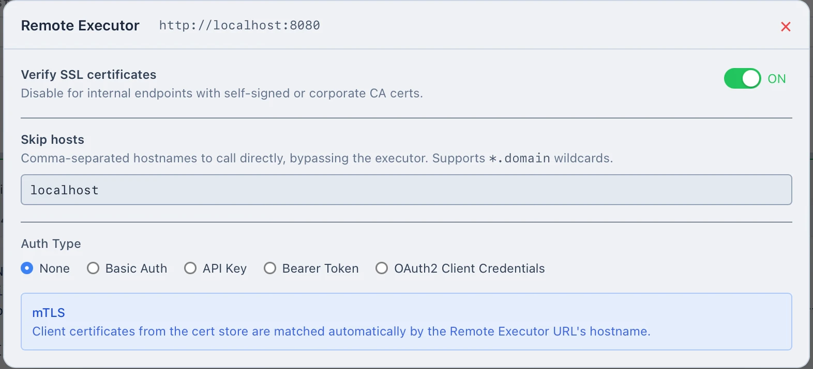

# Kbootar Remote Executor

A Remote Executor runs HTTP requests on behalf of the Kbootar app, from the network where the executor lives (a VPN, a corporate network, a server with private CAs or client certificates).

The app resolves variables and attaches auth, then sends one fully resolved request to the executor. The executor performs the call and returns the response.

This repo holds the contract and reference implementations.

## Layout

```
openapi.yaml          the contract: POST /api/execute
examples/
  spring-boot/        reference implementation (Spring Boot, WebFlux)
```

`openapi.yaml` is the source of truth. Any service that implements it works with the app's Remote mode, in any language.

## Run the Spring Boot example

```bash
cd examples/spring-boot
mvn spring-boot:run -Dspring-boot.run.profiles=local
```

It listens on `http://localhost:8080`. In the app, switch to Remote mode and enter that URL.

`/mock/**` is a debugging echo endpoint specific to this example. It is not part of the contract.

## Securing the executor

The reference app has no authentication of its own. Run it behind a reverse proxy that terminates TLS and enforces auth, and expose only `POST /api/execute` (never `/mock`). It fetches any URL it is asked to, so keep it reachable only by callers you trust.

The Kbootar app can authenticate to the executor with Basic Auth, an API key header, or a Bearer token. Choose one in the app's Remote Executor settings and enforce the same scheme at your proxy; the app sends it as an ordinary request header on every call. OAuth2 and client-certificate (mTLS) options appear in the dialog but are not applied to the executor connection yet.



## Writing your own

1. Implement `POST /api/execute` as described in `openapi.yaml`.
2. Ignore unknown request properties. The app sends extra fields that are not part of the contract.
3. Return `200` with a `ProxyResponse` whenever the target answered, even with a 4xx or 5xx. Use `502` with a `ProxyError` only when the call itself could not be completed.
